# my-distro

A small Linux distribution built from source, with its own init system,
desktop pieces and two features most desktops don't have: **system-wide undo**
for every file change and **AI semantic file search** that finds files by
meaning. It boots as a live ISO in a VM and can install itself onto a disk.

Most of the parts that make it *this* distro are written in plain C and kept
short and commented, so you can read how an OS fits together: `init` (PID 1),
the taskbar, the login screen, the file history daemon and the search indexer.

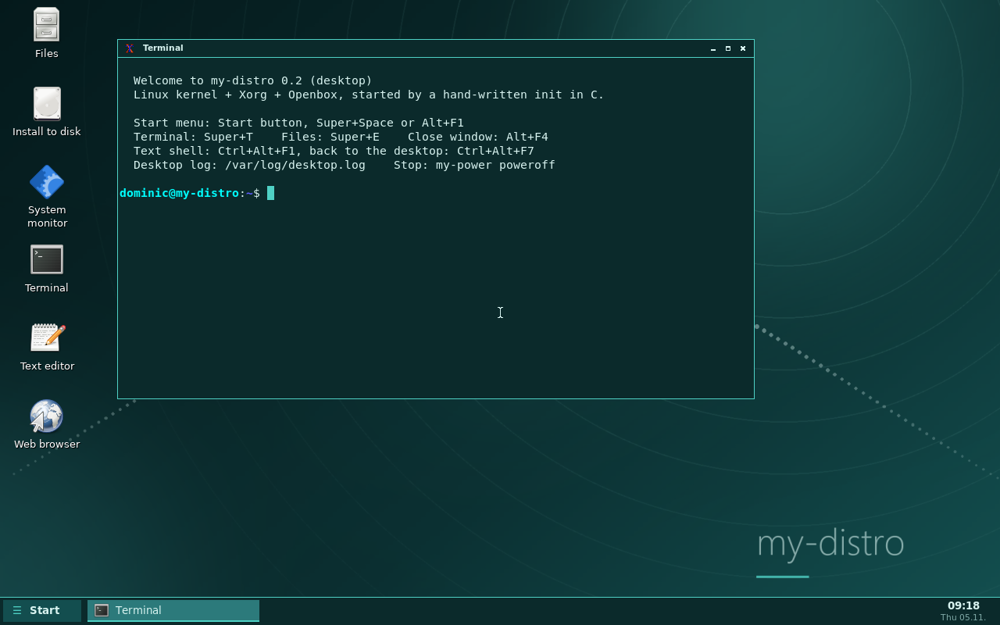

| Login screen | Semantic search |
|---|---|
| 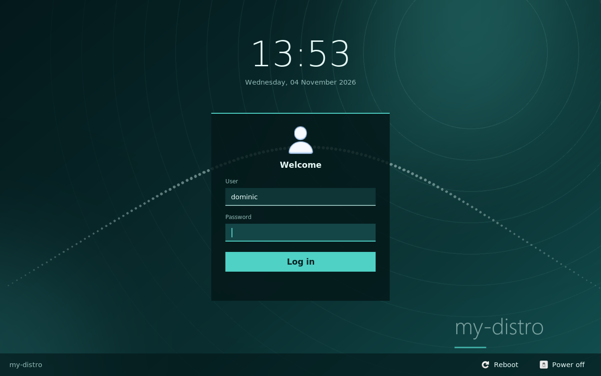 | 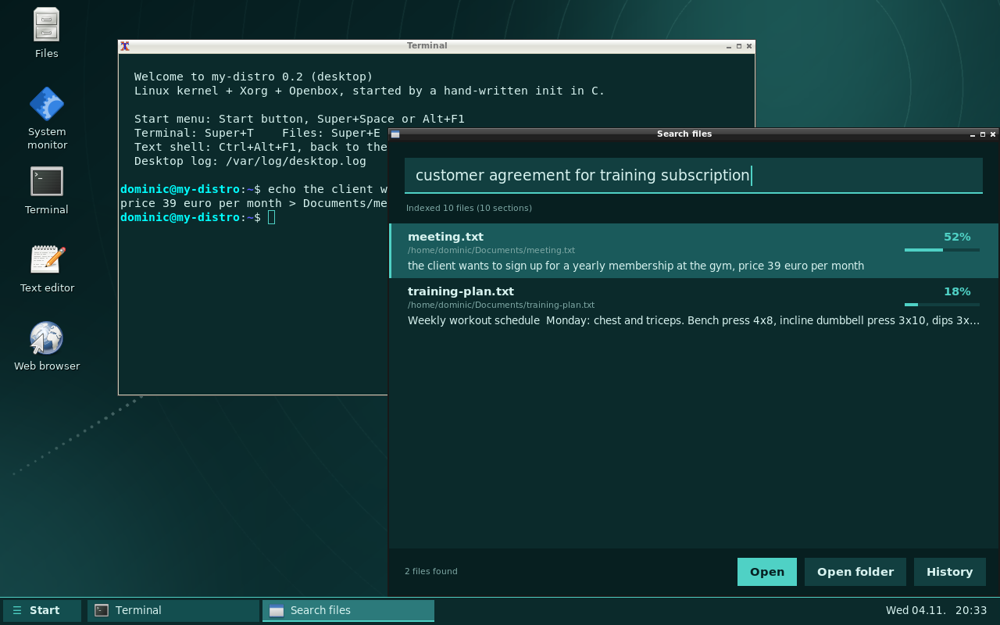 |
| **File history (undo)** | **Web browser** |
| 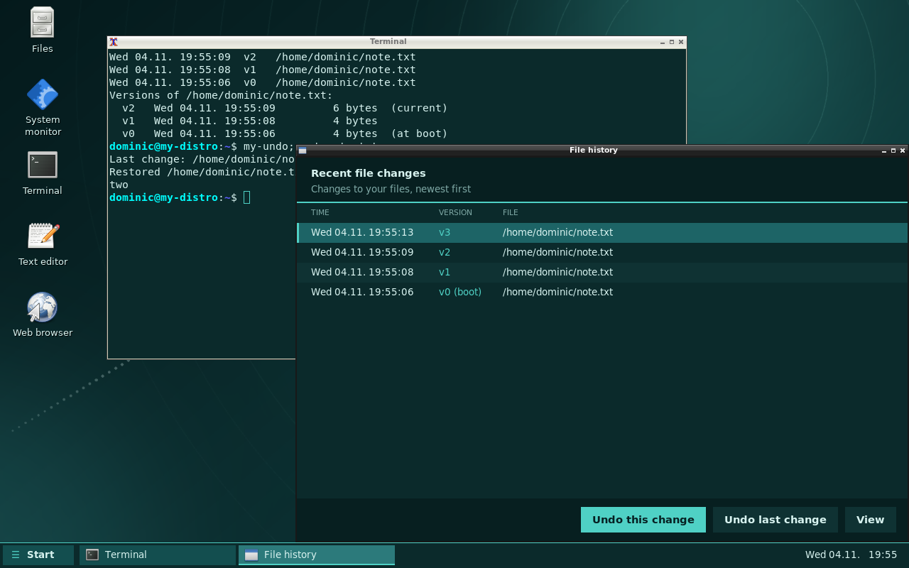 | 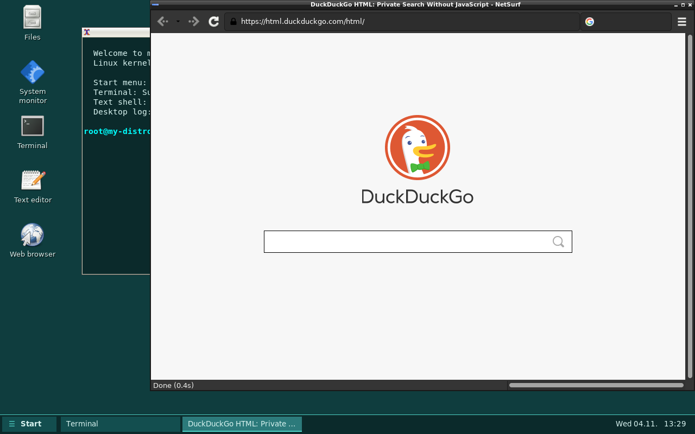 |
| **Settings** | **Clock and calendar** |
| 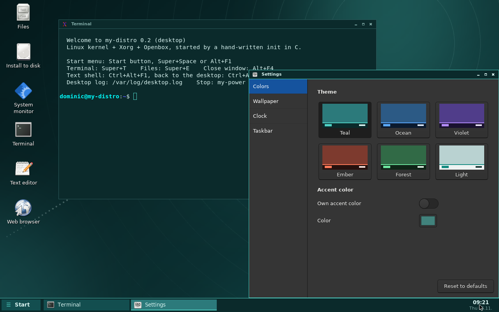 | 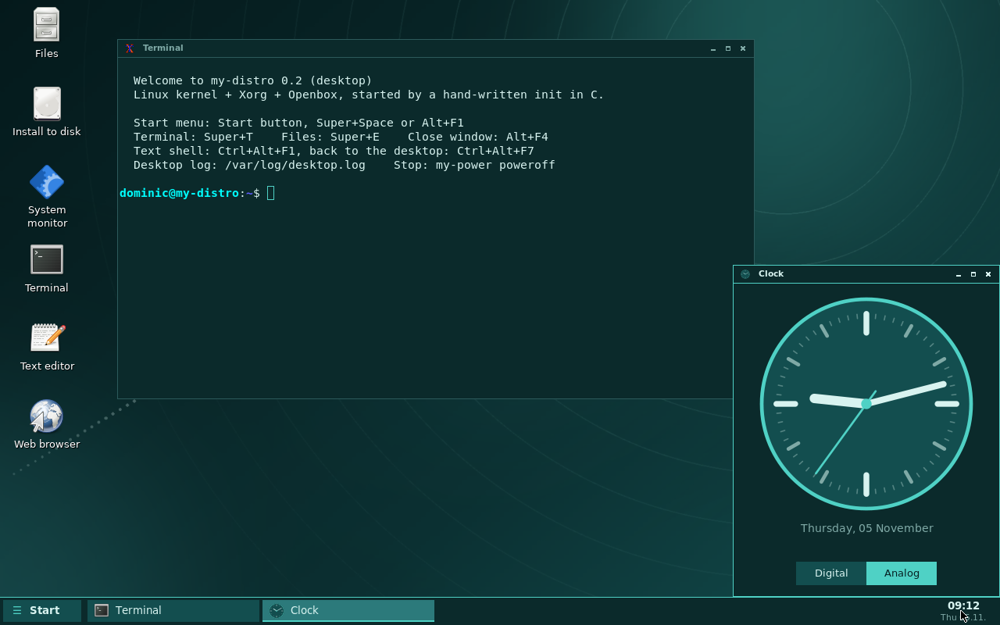 |
| **Another theme, taskbar on top, analog clock** | **Calendar (click the clock)** |
| 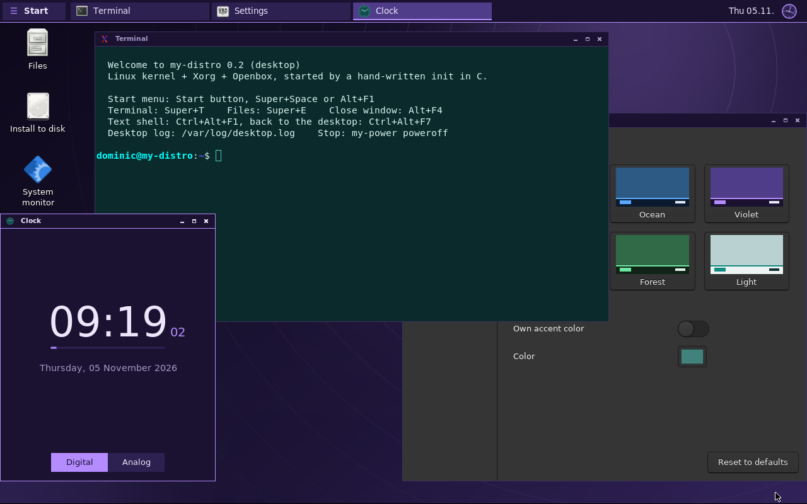 | 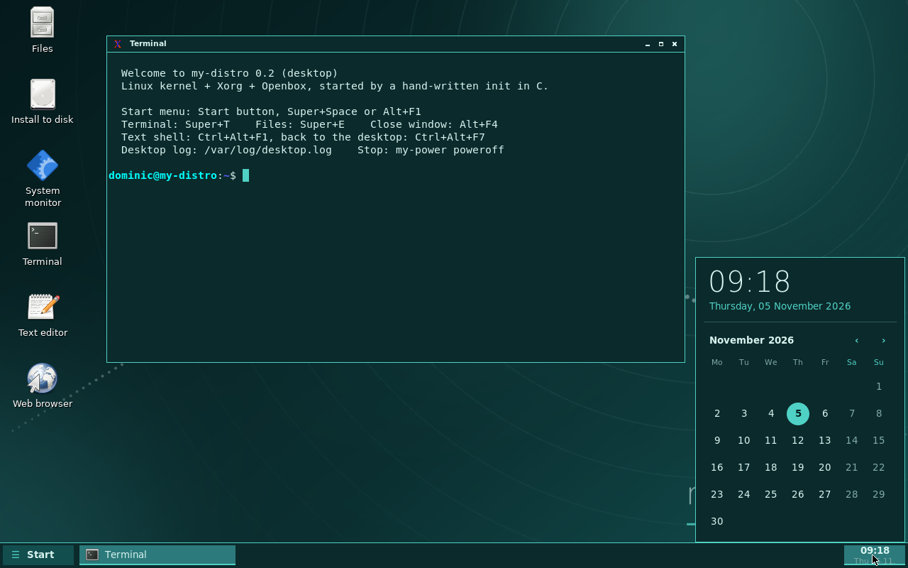 |
| **First-boot setup** | **Users and system** |
| 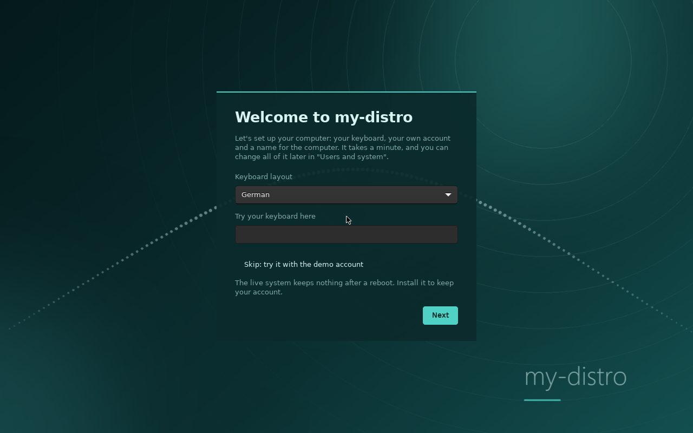 | 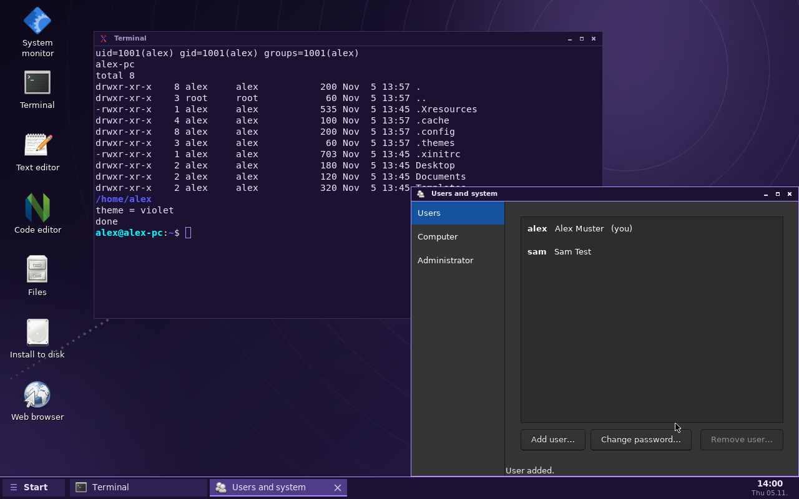 |

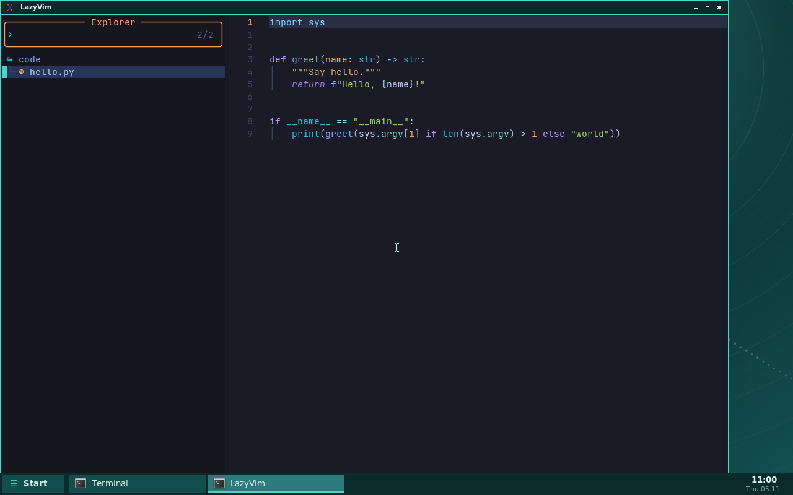

## Features

- **Own init in C** (`init/init.c`) as PID 1: mounts filesystems, runs the boot
  scripts, starts a login on the console, reaps zombies, reboots/powers off.
- **First-boot setup** (`settings/my-setup.c`): before the first login it
  asks for the keyboard layout, your name, user name and password, the
  computer's name and a color theme, and creates your account.
- **Users and system** (same program, Start menu or Settings): add and
  remove users, change passwords, the computer name and the keyboard layout.
  It asks for the root password; `login/my-admin.c` checks it.
- **System updates** (`my-update`): every new release on GitHub shows up as
  an *Update to …* button in the taskbar of installed systems. One click (and
  the root password) downloads it, checks its signature and installs it;
  your files, users and settings stay. See [System updates](#system-updates).
- **Graphical login** (`login/my-login.c`): checks passwords against
  `/etc/shadow`, drops root rights and starts your desktop as you.
- **Taskbar** (`panel/my-panel.c`): Start menu with icons, a button per window
  with the app's icon, and a clock (digital or a small analog face) that opens
  a calendar when you click it.
- **Settings app** (`settings/my-settings.c`): six color themes or your own
  accent color, wallpaper, clock style and format, taskbar position and size.
  Changes apply at once to the taskbar, window borders, wallpaper, terminal
  and the login screen.
- **Clock app** (`settings/my-clock.c`): a big analog or digital clock.
- **IDE:** Neovim with [LazyVim](https://www.lazyvim.org/) (*Code editor* in
  the Start menu, or `my-ide [file]`). Plugins and syntax parsers for 32
  languages come preinstalled, so it works without internet. git, ripgrep
  and fd included.
- **System-wide undo** (`history/`): every file that any program changes is
  saved as a version (kernel *fanotify*). Undo from a window or with `my-undo`.
- **Semantic file search** (`search/`): an embedding model (all-MiniLM-L6-v2 via
  llama.cpp) indexes your files by meaning. *"customer agreement for training
  subscription"* finds a note about a client signing up for a gym membership,
  without a single shared word.
- **Desktop:** Xorg, Openbox, PCManFM file manager with desktop icons, NetSurf
  web browser (HTTPS), xterm, nano, htop, calculator, generated wallpapers.
  Right-click in a Files window, *Create New…* makes text, Markdown, shell, Python, C, HTML,
  CSS, JavaScript, JSON, CSV, Lua, Makefile and config files from templates
  (`~/Templates`).
- **Python 3** with pip, so `.py` scripts run (`python3 file.py`).
- **Live ISO** for BIOS and UEFI, from a CD or a USB stick; tested in
  VirtualBox and QEMU. Drivers for real PCs: Intel and AMD graphics,
  Realtek and Intel network cards, Wi-Fi, laptop touchpads.
- **Wi-Fi** (`settings/my-wifi.c`): bars in the taskbar show the signal; a
  click lists the networks around, asks for the password and connects
  (wpa_supplicant underneath; started by a udev rule when an adapter appears).
  Networks with a user name and password (eduroam, WPA2/WPA3 Enterprise:
  PEAP or TTLS, with the server's certificate checked against its domain) and
  hidden networks (*Other network…*) work too.
- **VPN** (`settings/my-vpn.c`, Start menu *VPN*): import a WireGuard config
  file (`.conf`) from your VPN service or router, then connect and
  disconnect. `login/my-vpnctl.c` does the root part (for members of
  `netdev`, like Wi-Fi) and never runs commands from the file (PostUp & co
  are left out).
- **Installer** (`my-install`): copies the live system onto a hard disk with
  GRUB for BIOS and UEFI, so your files and settings survive a reboot.
- **Sound**: a speaker in the taskbar shows the volume. Scroll on it for
  louder/quieter, click to mute, right-click for all controls (alsamixer).
  The volume keys work too (`my-volume up|down|mute`). Your volume is
  remembered for the next login. Drivers for the sound chips of most PCs
  (Intel HD Audio with Realtek, Conexant, Cirrus, IDT, VIA codecs, HDMI)
  and USB headsets.
- **Notifications** (`settings/my-notifyd.c`): small boxes in the corner
  next to the taskbar, in the colors of your theme. Any program can send one
  over the standard freedesktop D-Bus interface; from a script:
  `my-notify "Title" "Text"` (also called `notify-send`).
- **USB sticks and SD cards** open by themselves in `/media/NAME`, with a
  notification: FAT, exFAT, NTFS (Windows), ext4, CDs/DVDs. To remove one
  safely: right-click its folder, *Eject* (or Start menu, *Eject USB stick*,
  or `my-eject`). Internal disks are never opened by themselves.
- **Screenshots** (`panel/my-screenshot.c`): Print = whole screen,
  Alt+Print = the window in front, Shift+Print = drag an area; or Start
  menu, *Screenshot*. They go to `~/Pictures`.
- **Firewall** (nftables): nobody can connect to this computer from outside;
  everything you start (web, updates) works as before. Rules in
  `/etc/nftables.conf`, your own in `/etc/nftables.d/`.
- **Time from the internet**: the clock sets itself (BusyBox `ntpd`,
  `pool.ntp.org`) and keeps the hardware clock right too.
- **sudo**: administrators run commands as root with their own password.
  The account from the setup is one (when it shares its password with root);
  *Users and system* makes others administrators.
- **Laptops**: the battery's charge in the taskbar (a warning below 10 %),
  *Suspend* in the Start menu. Closing the lid locks the screen and puts the
  laptop to sleep (`login/my-lidd.c`, settings in `/etc/my-distro/power.conf`);
  the brightness keys work.
- **Screen lock** (`login/my-lock.c`): Super+L, Start menu *Lock screen*,
  before sleeping, and after 10 minutes without use (Settings, *Screen
  lock*). Notifications wait until you unlock.
- **Display settings** (Settings, *Display*): resolution, a second screen
  (extend to any side, mirror, only one), size of text and icons. A
  countdown brings the old settings back if the screen goes black.
- **Media player**: mpv plays videos and music (double-click a file, or Start
  menu *Media player*), with on-screen controls.
- **Time zone** in the setup and in *Users and system*.
- **More memory**: compressed swap in RAM (zram, zstd), so a 2 GB computer
  doesn't run out when the search model and a browser are open.
- **Parts restart themselves** (`my-keepalive`): if the taskbar,
  notifications, file history, lid switch or the login screen crash, they
  start again.
- **Start menu on the Windows key**: press and release Super on its own
  (`panel/my-panel.c` listens with XInput 2, so Super+L and the other
  shortcuts still work). On small screens the menu has two columns.
- **Clipboard that stays** (`panel/my-clipd.c`): copied text can still be
  pasted after the program you copied it from is closed.
- **Screen recording** (`my-record`): Start menu *Record screen* or
  Super+Shift+R starts it, the same again stops it. The video (MPEG-4, no
  sound) goes to `~/Videos`.
- **Camera** (`my-camera`): USB webcams and laptop cameras (UVC) in an mpv
  window; S takes a photo into `~/Pictures`.
- **System logs** (`settings/my-logs.c`): system messages, kernel messages
  and the services' logs in one window, with a search that keeps only the
  matching lines.
- **Recovery mode and factory reset**: the installed system's boot menu has
  *recovery mode* (text console only, no desktop) to undo an update or
  reset. The factory reset (*Users and system* → *Factory reset*, or
  `my-reset`) deletes all users, files and settings and keeps the system;
  the setup starts again.
- **Bluetooth** (`settings/my-bluetooth.c`): a Bluetooth sign in the
  taskbar (accent color while something is connected) opens the window:
  switch it on and off, search, pair (it shows or asks for the PIN when the
  device wants one), connect, disconnect, forget. Keyboards, mice,
  headphones and speakers. BlueZ underneath; drivers and firmware for
  Intel, Realtek, MediaTek, Qualcomm and Broadcom chips and USB dongles.
  Headphones get the sound through bluez-alsa (no sound server): while they
  are connected, programs you start play there (see
  [Limitations](#limitations)).
- **Printing** (`settings/my-printers.c`, Start menu *Printers*): CUPS with
  driverless printing (IPP Everywhere / AirPrint: nearly every network
  printer since ~2015 needs no driver), Gutenprint and HPLIP for older
  USB printers. *Add printer…* finds them in the network and on USB, or
  takes an address. Print from the browser, any GTK program or `lp FILE`.
  The printer **PDF** saves what you print as a PDF in `~/PDF`. CUPS only
  listens on this computer; *More settings* opens its web page
  (`http://localhost:631`).
- **Scanning**: *Scan…* in the Printers window (SANE, with sane-airscan for
  network scanners and all-in-one printers); pictures go to `~/Pictures`.
- **3D graphics**: Mesa with real drivers: AMD (radeonsi, r600; Vulkan:
  radv), VMware/VirtualBox (svga), QEMU (virgl), and llvmpipe (fast
  software 3D on the CPU) on any other computer, Intel included. Xorg
  draws with the graphics chip (glamor). `glxinfo -B` shows the renderer,
  `glxgears` is a quick test.
- **Disks** (`settings/my-disks.c`, Start menu *Disks*): the disks and
  partitions; format a USB stick, SD card or partition as FAT32, exFAT,
  ext4 or NTFS, and check and repair a filesystem. It asks for the root
  password. Partitions the running system uses can't be chosen; other
  partitions on that disk and every internal disk need their name typed
  in after a red warning.
- **Backup** (`settings/my-backup-gui.c`, `my-backup`): copies your home
  folder to a USB stick or disk, each time only what changed (rsync with
  hard links: every backup looks complete). Optionally also the system's
  settings (Wi-Fi, VPNs, printers, Bluetooth, users; root password).
  *Restore* puts a chosen backup back. A notification says when it's done.
- **Accessibility** (Settings, *Accessibility*): high-contrast themes (dark
  and light, also in the first-boot setup), size of text and icons, a
  bigger mouse pointer, a magnifier (Super+Z, `panel/my-zoom.c`), reading
  the selected text aloud (Super+R, eSpeak, `panel/my-speak.c`) and an
  on-screen keyboard (Super+K, Start menu, and the *Keyboard* button on
  the login screen).

## Try it

**Don't want to build it?** Download a ready ISO from
[Releases](https://github.com/dominicdiesahne/my-distro/releases/latest)
and go to step 2.

### 1. Build the ISO

You need a Linux machine (or WSL2 on Windows) with about **20 GB of free disk**
and a few hours of time for the first build. Buildroot compiles everything
from source: the toolchain is prebuilt, but the kernel, Xorg, GTK and the rest
are not. Rebuilds after that take minutes.

Build tools (Debian/Ubuntu/Kali):

```bash
sudo apt install build-essential bc bison flex libelf-dev libssl-dev libncurses-dev cpio wget rsync unzip file patch perl bzip2 python3 qemu-system-x86
```

Then:

```bash
git clone https://github.com/dominicdiesahne/my-distro.git
cd my-distro
make desktop
```

The result is **`out/my-distro.iso`** (~500 MB). Build files go to
`~/my-distro-build` (change with `make desktop BUILD=/some/path`), not into
the repository. Kali on WSL: `setup-kali.sh` fixes the usual Kali/WSL update
problems and installs the tools.

### 2. Boot it

```bash
make run-iso      # QEMU
```

**VirtualBox:** New VM, type *Linux*, version **Other Linux (64-bit)** (it must
be a 64-bit type, otherwise the kernel can't start and the screen stays black),
2048 MB RAM, 2 CPUs, no hard disk. Settings, Storage: put `my-distro.iso` in
the optical drive. Display: graphics controller *VMSVGA*. Start.
(The live system keeps its files in RAM, about 1 GB: 2 GB of RAM works,
3 GB is more comfortable. An installed system needs much less.)

**VMware:** new VM from the ISO, *Other Linux 6.x kernel 64-bit*, 2 GB RAM.
**Hyper-V:** Generation 2 VM, 2048 MB RAM, **Secure Boot off**, ISO in the DVD drive.

In the boot menu, *safe graphics* helps if the screen stays black.

#### On a real PC

Write the ISO to a USB stick (at least 1 GB; **everything on it is
deleted**):

- **Windows:** [Rufus](https://rufus.ie): choose the ISO, and when it asks,
  **"Write in DD image mode"**. Or [balenaEtcher](https://etcher.balena.io).
- **Linux:** `sudo dd if=my-distro.iso of=/dev/sdX bs=4M status=progress && sync`
  (`/dev/sdX` = the stick, check with `lsblk`; the wrong letter overwrites
  another disk).

Then start the PC from the stick (the boot menu key is usually F12, F11, F8
or Esc). In the firmware settings, **Secure Boot must be off**: my-distro's
boot loader is not signed. The live system runs from RAM and changes nothing
on the PC's disk unless you run *Install to disk*.

What works: Intel and AMD graphics (the screen's resolution, several
monitors; 3D with the graphics chip on AMD, with llvmpipe on Intel), wired
network with Intel or Realtek cards,
Wi-Fi (below), Bluetooth, laptop touchpads (I2C) and USB keyboards and
mice, NVMe, SATA and USB disks, Intel HD Audio, printers (network and
USB). NVIDIA graphics only get the basic firmware screen.

**Wi-Fi:** click the Wi-Fi bars in the taskbar (or Start menu, *Wi-Fi*),
pick a network, type its password. my-distro remembers it
(`/etc/wpa_supplicant.conf`, kept by system updates) and connects again by
itself. Drivers and firmware are in for Intel, Qualcomm Atheros, MediaTek,
Realtek and Broadcom chips, and most USB Wi-Fi sticks. Networks without a
name (hidden) and enterprise Wi-Fi (eduroam, username + password) can't be
chosen in the window yet; `wpa_cli` in a terminal can.

If something doesn't work, a terminal shows what the PC has: `lspci -k`
(each device and the driver that took it), `dmesg | grep -i firmware`.

### 3. Set it up and log in

The **setup** comes first: keyboard layout, your account (name, user name,
password), a name for the computer and a color theme. Your password is also
the administrator (root) password, unless you untick that and choose another.
Then log in with your new account.

On the live system you can **skip** the setup and use the demo account:

| User | Password | |
|---|---|---|
| `dominic` | `dominic` | normal user, pre-filled on the login screen |
| `root` | `root` | administrator |

The live system runs in RAM and forgets everything (also the account from the
setup) when it shuts down, unless you [install it](#4-install-to-a-disk-optional).
Change users and passwords later in **Users and system** (Start menu), or your
own password with `passwd`.

### 4. Install to a disk (optional)

The live system forgets everything when it shuts down. To keep your files,
install it onto a hard disk:

1. Give the VM a hard disk: **VirtualBox** Settings, Storage, add a hard disk
   (8 GB is plenty, dynamically allocated). In QEMU: `make run-install`.
2. Boot the ISO and log in, then double-click **Install to disk** on the
   desktop (or Start menu, *Install to disk*; or `my-install` as root).
   It asks for the root password (yours from the setup, or `root` if you
   skipped it).
3. Pick the disk, type `yes`. **Everything on that disk is deleted.**
   It copies the system (a minute or two) and installs GRUB. If you did the
   setup, your account is copied too; if you skipped it, the installed system
   starts with the setup.
4. Power off, remove the ISO from the optical drive (VirtualBox: Storage,
   click the CD, *Remove disk from virtual drive*), start the VM again.
   QEMU: `make run-disk`.

It now boots from the disk, and changes stay. The disk gets three
partitions: 1 MB for GRUB on BIOS PCs, 256 MB EFI system partition for UEFI,
the rest is the system (ext4). It boots with BIOS and UEFI alike.

### Keyboard shortcuts

| Shortcut | Does |
|---|---|
| Super (alone), Super+Space or Alt+F1 | Start menu |
| Super+S | Search files |
| Super+T or Ctrl+Alt+T | Terminal |
| Super+E | File manager |
| Super+Up / Super+Down | Maximise / minimise |
| Print / Alt+Print / Shift+Print | Screenshot: screen / window / area |
| Super+Shift+R | Start / stop recording the screen |
| Super+L | Lock the screen |
| Super+Z, Super+plus / Super+minus | Magnifier on/off, bigger / smaller |
| Super+R | Read the selected text aloud (again: stop) |
| Super+K | On-screen keyboard on/off |
| Volume keys, brightness keys, Sleep key | Louder, quieter, mute; brighter, darker; lock and suspend |
| Alt+Tab, Alt+F4 | Switch / close windows |
| Ctrl+Alt+F1 / Ctrl+Alt+F7 | Text console / back to the desktop |

The keyboard layout is German (`desktop/overlay/etc/X11/xorg.conf.d/00-keyboard.conf`).

## How it works

### Boot

1. GRUB loads the kernel and the whole root filesystem into RAM (initrd).
2. The kernel starts our init, `/sbin/my-init` (`init/init.c`).
3. init mounts `/proc`, `/sys`, `/dev`, `/tmp` and runs `/etc/init.d/rcS`:
   `S00reset` (a factory reset, if one was asked for),
   udev, `S20zram` (compressed swap), the system D-Bus, `S35firewall`,
   `S40bluetoothd` and `S41bluealsa` (Bluetooth and its sound), network
   (DHCP), `S45sound`, `S46power` (lid switch), `S48time` (clock from the
   internet), `S50avahi-daemon` (finds printers), `S50history` (file
   history), `S81cupsd` (printing), `S90desktop`. Daemons run under
   `my-keepalive`, which starts them again if they crash.
4. `S90desktop` starts the X server with **`my-login`** as its only client.
5. After login, `my-login` drops root rights and runs `~/.xinitrc` as you,
   which starts the session D-Bus and Openbox. Openbox runs your
   `~/.config/openbox/autostart`, which first runs the system's
   `/usr/lib/my-distro/autostart` (notifications, taskbar, screen lock, search
   indexer, desktop icons; updated by system updates) and then your own
   programs (a terminal).
6. *Log out* ends the session and the login screen comes back.
   *Power off* sends init `SIGUSR2`: it stops all processes, makes the root
   filesystem read-only (installed system) and powers off.

On an installed system GRUB starts the kernel from `/boot/bzImage` on the
ext4 partition with `root=PARTUUID=... init=/sbin/my-init`, so step 1 loads
no initrd: the kernel mounts the disk itself and the rest is the same.

Its boot menu also has **recovery mode** (`my-recovery` on the kernel line):
`S50history` and `S90desktop` don't start, so there is only the text console.
After logging in as root it lists what helps: `my-update rollback` (undo the
last update), `my-reset` (factory reset), `passwd`.

### Factory reset

`my-update keep-list` lists everything system updates keep: users and
passwords, home folders, `/var`, the computer name, Wi-Fi networks, VPNs, the
time zone and other settings. While the image is built,
`desktop/post-fakeroot.sh` copies the fresh state of these into
`/usr/share/my-distro/factory` (root only). `my-reset` marks a reset and
restarts; at the next start `S00reset` deletes all of them, puts the factory
copies back and runs `installed-fixups`. Then the setup runs as after
installing. The system's own files stay in the version they have.

### System-wide undo

`my-historyd` (root) asks the kernel's **fanotify** for `FAN_CLOSE_WRITE` on the
whole root filesystem, so it hears about every file any program wrote and
closed. It copies each such file into `/var/lib/my-history/store/` as the next
version (up to 50 per file); at boot it saves `/etc`, `/root` and `/home` as
version 0. Versions belong to the file's owner, so users only see their own
files. Paths in `/etc/my-history/exclude` (logs, caches) are skipped.

| Command | Does |
|---|---|
| `my-undo` | undo your last change (run twice = redo) |
| `my-undo list` | recent changes |
| `my-undo history FILE` | versions of FILE |
| `my-undo restore FILE N` | restore version N |
| `my-undo show FILE N` | print version N |

The **File history** window (Start menu, or right-click a file in the file
manager) shows the same with buttons.

### Semantic search

The embedding model **all-MiniLM-L6-v2** (25 MB, run by llama.cpp on the CPU)
turns a text into 384 numbers that describe its meaning. `my-indexd` runs in
each session, cuts the text files in your home folder into ~700-character
sections and stores one vector per section in `~/.cache/my-search/`; other
files are indexed by name. It picks up new, changed and deleted files every
5 seconds. A search turns your query into a vector and ranks files by cosine
similarity, plus a small bonus for exact word matches.

Use the **Search files** window (Super+S) or `my-search what you are looking for`.
The model is English; German text works poorly. PDFs and office files are found
by name only.

### Bluetooth

BlueZ's `bluetoothd` runs as root. The Bluetooth window talks to it over the
system D-Bus (`org.bluez`: adapters, devices, Pair, Connect), like
`bluetoothctl` in a terminal does; members of `netdev` may
(`/etc/dbus-1/system.d/my-bluetooth.conf`). While pairing, the window is
bluetoothd's *agent*: bluetoothd asks it "does the device show 123456?" or
"which PIN?", and it asks you. Paired devices are *trusted*, so they
connect by themselves later; pairings are kept in `/var/lib/bluetooth`.

Sound: `bluealsad` (bluez-alsa) makes a connected headphone an ALSA
device. `my-bluetooth --watch` (started at login) sees it connect and
writes a few marked lines into `~/.asoundrc` that make it the default
output; they go again when it disconnects.

### Printing

`cupsd` listens on `localhost:631` and its socket only, so the firewall
stays closed. The Printers window uses CUPS's tools: `lpinfo -v` finds
printers (USB, and in the network through Avahi/mDNS: the firewall lets in
only those multicast answers, and Avahi announces nothing), `lpadmin -m
everywhere` sets up a driverless printer (CUPS asks the printer what it
can do), `lpinfo --device-id … -m` finds a Gutenprint or HPLIP driver for
an older USB one. Members of `lpadmin` may change printers. The *PDF*
printer is `/usr/lib/cups/backend/my-pdf`: it saves the PDF that CUPS made
into the folder `PDF` of whoever printed.

### Backup

`my-backup backup /media/STICK` makes
`/media/STICK/my-backup/COMPUTER-USER/2026-11-07_183000/home`, a copy of
your home folder. rsync's `--link-dest` hard-links every file that didn't
change to the previous backup's copy, so each backup is complete, but only
changes take room. A backup is finished when its `done` file is there;
`my-backup list` and `my-backup restore DISK NAME` (copies it back; files
made later stay). With `--settings` (as root; the window asks for the
password and runs it through `my-admin`) the settings that system updates
keep go to `system/` too. FAT and exFAT can't hold hard links or
permissions: there each backup is a full copy (format the stick as ext4
in *Disks* for incremental backups; ext4 sticks made there belong to you).

## IDE (LazyVim)

*Code editor* on the desktop or in the Start menu opens LazyVim in a terminal
with the JetBrains Mono Nerd Font (for its icons). Press `Space` and wait to
see all shortcuts; `Space e` file tree, `Space Space` find files,
`Space /` search in files, `Space g s` git status,
`:Lazy` plugins, `:Mason` language servers (needs internet).

How it gets there: Buildroot has no Neovim, so `desktop/package/my-ide`
takes the official prebuilt one (x86-64, glibc, like my-distro). During the
build, that same Neovim runs on the build machine, installs LazyVim's
plugins at the versions in `desktop/lazyvim/lazy-lock.json`, and compiles
the tree-sitter parsers with my-distro's cross-compiler. The plugins and
parsers go to `/usr/share/my-ide` once, read-only, for all users; every new
user's home gets the config (`desktop/lazyvim` = `~/.config/nvim`) and links
to them from `/etc/skel`.

my-distro has no C compiler, so `:TSInstall` for more languages doesn't
work on the running system, and `:Lazy update` can't change the shared
plugins; add languages to `desktop/package/my-ide/parsers.lua` and rebuild.

## System updates

An installed my-distro looks for a new release at every login and every
6 hours. When there is one, the taskbar shows **Update to 0.9** next to the
clock; it opens *System update* (also in the Start menu, and a page of
*Users and system*) with the release notes and an **Install update** button.

What happens (`/usr/bin/my-update`, a Python script):

1. It asks GitHub for the latest release
   (`https://api.github.com/repos/dominicdiesahne/my-distro/releases/latest`,
   set in `/etc/my-distro/update.conf`) and compares its version with
   `/etc/my-distro/version`.
2. It downloads the release's **update package** `my-distro-update.tar.xz`
   (the whole root filesystem), its SHA-256 sum and a **signature** of that
   sum, to `/.my-update` on the system disk.
3. It checks the signature with the public key `/etc/my-distro/update-key.pem`
   (Ed25519, `openssl pkeyutl -verify`), then the sum. A package that was not
   signed with the maintainer's private key is refused, even if someone
   tampers with the download.
4. It unpacks the package and moves the new files into place (renames on the
   same disk, so each file is either the old or the new one, never half).
   It **keeps** `/home`, `/root`, `/var`, users and passwords
   (`/etc/passwd`, `shadow`, `group`), the computer name, the keyboard layout,
   the boot loader, the saved Wi-Fi networks and `update.conf`.
5. It runs `/usr/lib/my-distro/installed-fixups` (same as the installer:
   no "Install to disk" icon; it also adds what a new version needs to the
   session files in the home folders, which updates never replace), and
   you restart.

**Undo an update.** Before a file is replaced, the updater keeps the old
one in `/.my-update/previous` (a hard link, so it costs no time). If
something doesn't work after an update, *System update* shows **Undo last
update (back to 0.9.2)**: it puts the old files back and removes the ones
the update added. If the desktop doesn't start any more, log in as root on
the text console (Ctrl+Alt+F1) and run `my-update rollback`. One step back
is kept, until the next update. This works for updates installed by 0.9.2
or newer (the update *to* 0.9.2 is still done by the old updater).

The **live ISO** can't keep an update (it runs from RAM), so there it only
says that a new ISO is out. Systems before 0.8 have no updater: install the
0.8 ISO once, updates come by themselves after that.

From a terminal: `my-update check --notes`, and as root `my-update install`
or `my-update rollback`.

## Project layout

| Path | What it is |
|---|---|
| `Makefile` | `make desktop` (ISO and update package), `make release-files` (signature), `make run-iso`; `make` / `make run` for the minimal version |
| `init/init.c` | PID 1 |
| `login/` | Login screen `my-login`, screen lock `my-lock` with `my-checkpass`, lid switch `my-lidd`, `my-power` (reboot, power off, suspend, brightness, eject USB sticks for normal users), `my-admin` (root password check for Users and system, Disks and Backup), `my-vpnctl` (the VPN window's root part) |
| `settings/my-bluetooth.c`, `my-printers.c`, `my-disks.c`, `my-backup-gui.c` | The Bluetooth, Printers (and Scan), Disks and Backup windows |
| `desktop/overlay/usr/lib/my-distro/disk-tool`, `usr/bin/my-backup` | What Disks does as root (format, fsck); the backup command |
| `panel/my-zoom.c`, `panel/my-speak.c`, `desktop/overlay/usr/bin/my-keyboard` | Magnifier, read aloud, on-screen keyboard |
| `desktop/overlay/etc/cups/`, `usr/lib/cups/backend/my-pdf`, `etc/init.d/S81cupsd`, `S41bluealsa` | Printing settings, the PDF printer, start scripts |
| `desktop/overlay/usr/lib/my-distro/vpn` | Connects and disconnects a WireGuard VPN (run by `my-vpnctl`) |
| `desktop/overlay/usr/sbin/my-reset`, `etc/init.d/S00reset`, `desktop/post-fakeroot.sh` | Factory reset, and the factory copy it puts back |
| `desktop/overlay/usr/bin/my-record`, `my-camera` | Screen recording, webcam |
| `desktop/overlay/usr/sbin/my-install` | Installer (shell script) |
| `desktop/overlay/usr/bin/my-update` | System updates (Python), settings in `desktop/overlay/etc/my-distro/update.conf`, public key `update-key.pem` |
| `desktop/overlay/etc/my-distro/version` | The version number (the welcome text and `my-update` read it) |
| `panel/` | Taskbar `my-panel` (with volume and battery), `my-screenshot`, `my-clipd` (keeps copied text) |
| `settings/my-notifyd.c`, `settings/my-notify.c` | Notifications: the daemon that shows them, and the command that sends one |
| `desktop/overlay/usr/lib/my-distro/automount` | Opens USB sticks and SD cards (started by a udev rule) |
| `desktop/overlay/usr/lib/my-distro/autostart` | The desktop's own parts at login (users' autostart runs it first) |
| `desktop/overlay/usr/bin/my-keepalive` | Starts a crashed program again (taskbar, daemons, login screen) |
| `desktop/overlay/etc/init.d/S20zram`, `S46power` | Compressed swap, lid switch |
| `desktop/overlay/etc/init.d/S35firewall`, `S45sound`, `S48time` | Firewall, sound start values, time sync |
| `desktop/busybox.fragment` | BusyBox options on top of Buildroot's (ntpd) |
| `desktop/lazyvim/`, `desktop/package/my-ide/` | The IDE: LazyVim config, and how Neovim and the plugins get into the image |
| `settings/` | Settings app, Clock app, setup / Users and system (`my-setup`), Wi-Fi (`my-wifi`), VPN (`my-vpn`) and log viewer (`my-logs`) windows, and `settings.c` / `dial.c` that the taskbar and login screen share with them |
| `history/` | `my-historyd`, `my-undo`, the File history window |
| `search/` | `my-indexd`, `my-search`, the Search files window |
| `desktop/buildroot.fragment` | Packages and settings on top of Buildroot's `qemu_x86_64_defconfig` |
| `desktop/linux-gui.fragment` | Extra kernel options (graphics, VM drivers, fanotify) |
| `desktop/package/` | How Buildroot builds our programs and downloads the search model |
| `desktop/overlay/` | Files copied into the root filesystem (config, Start menu, launchers) |
| `desktop/post-build.sh` | Last changes to the root filesystem (Openbox shortcuts, user home) |
| `desktop/users.table` | User accounts |
| `desktop/make-wallpaper.py` | Draws the wallpapers, one per theme, and the clock icon (Python + Pillow) |
| `desktop/make-bluetooth-icon.py` | Draws the Bluetooth icon (Python, no extra modules) |
| `config/`, `rootfs/` | The minimal version |

## Customize

### On the running system

Open **Settings** from the Start menu. Everything is saved to
`~/.config/my-distro/settings`, a short text file you can also edit by hand
(run `my-settings --apply` afterwards for the wallpaper and window colors;
the taskbar and clock notice the change by themselves):

| Setting | Values |
|---|---|
| `theme` | `teal`, `ocean`, `violet`, `ember`, `forest`, `light`, `contrast`, `contrast-light` (high contrast) |
| `accent` | `#rrggbb`, or empty for the theme's color |
| `wallpaper` | `theme`, `color` (plain), or the path of a picture |
| `wallpaper_mode` | `crop`, `fit`, `center`, `tile`, `stretch` |
| `panel_clock`, `clock_app` | `digital` or `analog` |
| `clock_24h`, `clock_seconds`, `clock_date` | `yes` or `no` |
| `date_format` | `strftime` format, e.g. `%a %d.%m.` |
| `panel_position` | `bottom` or `top` |
| `panel_height`, `font_size` | 28-56 pixels, 8-16 points |
| `scale` | size of text and icons, 100-200 (percent) |
| `cursor_size` | mouse pointer: 24 (normal), 32, 48, 64, 96 pixels |

Defaults for all users are in `/etc/my-distro/settings`
(`desktop/overlay/etc/my-distro/settings` in this repository). The login
screen uses the theme and wallpaper of the user it shows. Apps that were
already open when you changed the theme (and GTK apps' light/dark style)
change the next time they start.

### In the build

- **Users and passwords:** the demo account is in `desktop/users.table`
  (format: Buildroot manual, "Users table"), the live root password is
  `BR2_TARGET_GENERIC_ROOT_PASSWD` in `desktop/buildroot.fragment`. A new
  user's home is a copy of `/etc/skel`, made in `desktop/post-build.sh`.
  The setup runs while `/etc/my-distro/setup-done` is missing.
- **Add a program:** find it in Buildroot
  (`make -C ~/my-distro-build/buildroot-* O=~/my-distro-build/desktop-out menuconfig`),
  add its `BR2_PACKAGE_...=y` line to `desktop/buildroot.fragment`, run `make desktop`.
- **Start menu:** `desktop/overlay/etc/my-panel/menu` (`Label|command|icon`).
- **Keyboard layout:** `desktop/overlay/etc/X11/xorg.conf.d/00-keyboard.conf`
  (the default; the setup changes it), the list offered in `settings/my-setup.c`.
- **Wallpapers:** edit `desktop/make-wallpaper.py` and run it.
- **Color themes:** the list in `settings/settings.c`; add a matching entry
  to `THEMES` in `desktop/make-wallpaper.py` for its wallpaper.

## Minimal version

Without Buildroot: kernel, BusyBox and `init.c` only, booting to a shell in
seconds.

```bash
make        # builds the kernel and BusyBox
make run    # boots in the terminal; quit with Ctrl-A, then X
```

## Limitations

- The installer wipes the whole disk: no dual boot next to Windows or
  another Linux.
- NetSurf has limited JavaScript; big web apps (YouTube, Google Docs) don't work.
- Only x86-64. Tested in VirtualBox and QEMU; the drivers for real PCs are
  in, but not yet tried on one (see [On a real PC](#on-a-real-pc)).
- Enterprise Wi-Fi (eduroam) knows PEAP and TTLS with a password; logins
  with a certificate instead of a password (EAP-TLS) are not in the window.
- VPN: WireGuard only (no OpenVPN). When you change networks while a VPN
  with "all traffic" is connected, disconnect and connect it again.
- Screen recordings have no sound.
- Sound plays on one card at a time (ALSA, no sound server). The digital
  microphones of some new laptops (Intel SOF) don't work yet.
- Bluetooth headphones: programs started while they are connected play
  there; ones that were already playing keep the old output until you start
  them again (no sound server moves them). The taskbar's speaker and the
  volume keys change the computer's own sound card, not the headphones
  (use the headphones' buttons). Headset microphones (HFP) are untested.
- 3D on Intel graphics runs on the CPU (llvmpipe): Mesa's iris, crocus and
  anv drivers need clang and libclc in the build, which are not in yet.
- Accessibility: there is no full screen reader yet (Orca needs AT-SPI's
  Python bindings, which Buildroot doesn't have); read aloud speaks the
  selected text only, with an English voice by default.
- mpv decodes videos on the CPU (no graphics acceleration): HD video is
  fine on most PCs, 4K is too much.

## License

The code in this repository is under the [MIT License](LICENSE).

The built ISO contains many other projects under their own licenses (Linux
and BusyBox under GPL-2.0, Xorg, GTK, Openbox, llama.cpp, ...). Buildroot can
list them and collect their sources: `make -C ~/my-distro-build/buildroot-*
O=~/my-distro-build/desktop-out legal-info`. The search model all-MiniLM-L6-v2
(by sentence-transformers) is Apache-2.0 and downloaded during the build.
